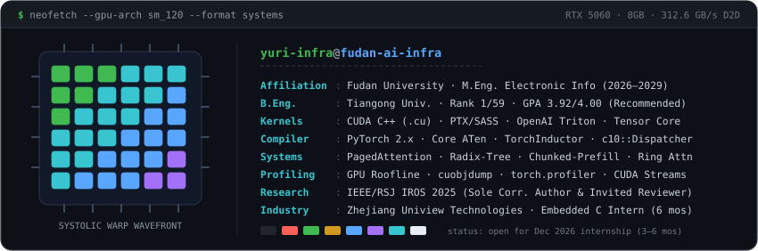
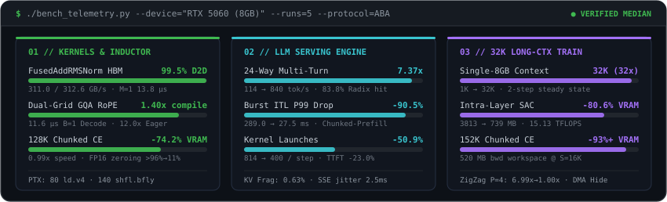

<div align="center">



</div>

<br/>

<div align="center">



</div>

<br/>

<div align="center">



</div>

---

### `// REPOSITORY_MATRIX`

| # | Repository | Stack | Core Engineering Highlights |
| :-: | :--- | :--- | :--- |
| **`01`** | [**`fused-cuda-triton-inductor`**](https://github.com/yuri-infra/fused-cuda-triton-inductor) | `CUDA C++ (.cu)` · `Triton` · `TorchInductor` · `c10::Dispatcher` | Native `uint4` vectorized `FusedAddRMSNorm` (**311.0 GB/s**, **99.5% D2D**, `cuobjdump` verified `80 ld.v4 / 140 shfl.bfly`); dual-grid single-launch GQA RoPE (**1.40x vs compile**); cache-isolated Core ATen Post-Grad 2-stage passes; `fullgraph=True` 128K Chunked Linear+CE (**-74.2% VRAM**). |
| **`02`** | [**`qwen-paged-serving`**](https://github.com/yuri-infra/qwen-paged-serving) | `Triton PagedAttention` · `Radix-Tree` · `Chunked-Prefill` · `asyncio` | 24-layer `Qwen2.5-0.5B-Instruct` serving engine: 7:1 GQA `BLOCK_G=16` Tensor Core Split-KV PagedAttention (**1.76x** vs SDPA); cross-project `.cu`/Triton fusion cutting launches **814 → 400 (-50.9%)**; `O(log N)` edge-splitting Radix-Tree + LIFO Swap (**ITL P99 -90.5%**, **7.37x** 24-way throughput, **0.63%** KV frag). |
| **`03`** | [**`qwen-32k-longctx-train`**](https://github.com/yuri-infra/qwen-32k-longctx-train) | `Triton FA2` · `ZigZag Ring Attn` · `SAC` · `Pinned Async DMA` | Single-8GB-GPU **32K (32x)** steady-state training for `Qwen2.5-0.5B`: zero-`atomic_add` Triton FA2; multi-process ZigZag Ring Attention (`P=4` imbalance **6.99x → 1.00x**, bwd max err `8.58e-6`); intra-layer SAC (**-80.6% VRAM** @ 15.13 TFLOPS); 152K in-place `addmm_` Chunked CE (**520 MB** @ 16K); dual-stream pinned async offload. |

---

### `// CONNECT`

```text
$ cat ~/.contact
email      : zhuhw26@m.fudan.edu.cn
location   : Shanghai, China (Fudan University · M.Eng.)
available  : Dec 2026+ · 3–6 months (4–5 days/week)
focus      : AI Infra Intern — GPU Kernels / Compilers / LLM Inference / Distributed Training
```
