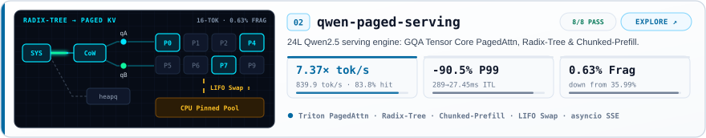
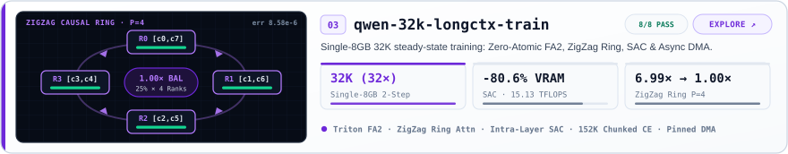

  <picture>
    <source media="(prefers-color-scheme: dark)" srcset="https://raw.githubusercontent.com/yuri-infra/yuri-infra/main/assets/hero-dark.svg?v=4">
    <source media="(prefers-color-scheme: light)" srcset="https://raw.githubusercontent.com/yuri-infra/yuri-infra/main/assets/hero-light.svg?v=4">
    
  </picture>

  <a href="https://yuri-infra.github.io"><strong>⚡ Interactive GPU Lab (yuri-infra.github.io) ↗</strong></a> &nbsp;·&nbsp;
  <a href="https://github.com/yuri-infra/fused-cuda-triton-inductor"><strong>01 Kernels &amp; Inductor</strong></a> &nbsp;·&nbsp;
  <a href="https://github.com/yuri-infra/qwen-paged-serving"><strong>02 Paged Serving</strong></a> &nbsp;·&nbsp;
  <a href="https://github.com/yuri-infra/qwen-32k-longctx-train"><strong>03 32K Long-Context</strong></a> &nbsp;·&nbsp;
  <a href="mailto:zhuhw26@m.fudan.edu.cn"><strong>Email</strong></a>

  <picture>
    <source media="(prefers-color-scheme: dark)" srcset="https://raw.githubusercontent.com/yuri-infra/yuri-infra/main/assets/bento-telemetry-dark.svg?v=4">
    <source media="(prefers-color-scheme: light)" srcset="https://raw.githubusercontent.com/yuri-infra/yuri-infra/main/assets/bento-telemetry-light.svg?v=4">
    
  </picture>

  <picture>
    <source media="(prefers-color-scheme: dark)" srcset="https://raw.githubusercontent.com/yuri-infra/yuri-infra/main/assets/gpu-timeline-dark.svg?v=4">
    <source media="(prefers-color-scheme: light)" srcset="https://raw.githubusercontent.com/yuri-infra/yuri-infra/main/assets/gpu-timeline-light.svg?v=4">
    
  </picture>

### `// FEATURED_SYSTEMS`

  <a href="https://github.com/yuri-infra/fused-cuda-triton-inductor">
    <picture>
      <source media="(prefers-color-scheme: dark)" srcset="https://raw.githubusercontent.com/yuri-infra/yuri-infra/main/assets/card-1-dark.svg?v=4">
      <source media="(prefers-color-scheme: light)" srcset="https://raw.githubusercontent.com/yuri-infra/yuri-infra/main/assets/card-1-light.svg?v=4">
      
    </picture>
  </a>

  <a href="https://github.com/yuri-infra/qwen-paged-serving">
    <picture>
      <source media="(prefers-color-scheme: dark)" srcset="https://raw.githubusercontent.com/yuri-infra/yuri-infra/main/assets/card-2-dark.svg?v=4">
      <source media="(prefers-color-scheme: light)" srcset="https://raw.githubusercontent.com/yuri-infra/yuri-infra/main/assets/card-2-light.svg?v=4">
      
    </picture>
  </a>

  <a href="https://github.com/yuri-infra/qwen-32k-longctx-train">
    <picture>
      <source media="(prefers-color-scheme: dark)" srcset="https://raw.githubusercontent.com/yuri-infra/yuri-infra/main/assets/card-3-dark.svg?v=4">
      <source media="(prefers-color-scheme: light)" srcset="https://raw.githubusercontent.com/yuri-infra/yuri-infra/main/assets/card-3-light.svg?v=4">
      
    </picture>
  </a>

<strong>Verified Benchmark Ledger (RTX 5060 sm_120 · 5-Run ABA Medians · 24/24 Tests Pass)</strong>

| System | Workload &amp; Target | Strong Baseline | Measured Result | Verified Delta &amp; Audit |
| :--- | :--- | :---: | :---: | :--- |
| **[01 · Kernels](https://github.com/yuri-infra/fused-cuda-triton-inductor)** | `FusedAddRMSNorm (.cu)` `[16384×4096 FP16]` | `312.6 GB/s` D2D | **`311.0 GB/s`** (`1726.2 μs`) | **99.5% D2D Roof** · `80× ld.v4` ([Report](https://github.com/yuri-infra/fused-cuda-triton-inductor/blob/main/benchmarks/local_gpu_benchmark_report.md)) |
| **[01 · Kernels](https://github.com/yuri-infra/fused-cuda-triton-inductor)** | Triton GQA RoPE (`B=1, S=1, 16Q/4KV`) | `16.2 μs` (`compile`) | **`11.6 μs`** (1 launch) | **1.40× compile** · **11.97× Eager** ([Code](https://github.com/yuri-infra/fused-cuda-triton-inductor/blob/main/ai_infra_fused_ops/kernels.py)) |
| **[01 · Kernels](https://github.com/yuri-infra/fused-cuda-triton-inductor)** | `Fused Linear+CE` (`M=4096, V=128K BF16`) | `1002.0 MB` activ | **`258.5 MB`** (`115.35 ms`) | **-74.2% Activ VRAM** · `0.99× compile` |
| **[02 · Serving](https://github.com/yuri-infra/qwen-paged-serving)** | 24-Way Multi-Turn (`16,384` KV slots, `t=0`) | `114.0 tok/s` (`35.99%`) | **`839.9 tok/s`** (`0.63%`) | **7.37× tok/s** · `83.8%` Radix hit ([Report](https://github.com/yuri-infra/qwen-paged-serving/blob/main/benchmarks/local_serving_benchmark_report.md)) |
| **[02 · Serving](https://github.com/yuri-infra/qwen-paged-serving)** | 12-Way Decode + `4×768` Burst (`budget=96`) | `289.03 ms` P99 | **`27.45 ms`** ITL P99 | **-90.5% Tail Latency** (`10.53×`) |
| **[02 · Serving](https://github.com/yuri-infra/qwen-paged-serving)** | 1056-Tok Hit TTFT + Cross-Repo `.cu` Fusion | `54.62 ms` / `814` ops | **`15.28 ms`** / **`400`** ops | **-72.0% TTFT** · **-50.9% CUDA launches** |
| **[03 · 32K Train](https://github.com/yuri-infra/qwen-32k-longctx-train)** | Single-8GB 2-Step Steady Max Context | `1,024` tokens | **`32,768` tokens** | **32.0× Context** · Full Qwen2.5 32K ([Report](https://github.com/yuri-infra/qwen-32k-longctx-train/blob/main/benchmarks/local_training_benchmark_report.md)) |
| **[03 · 32K Train](https://github.com/yuri-infra/qwen-32k-longctx-train)** | Intra-Layer SAC + Zero-Atomic Triton FA2 | `3813.0 MB` / `14.87 TF` | **`739.3 MB`** / **`15.13 TF`** | **-80.6% Activ VRAM** · `1.02×` Full-Ckpt |
| **[03 · 32K Train](https://github.com/yuri-infra/qwen-32k-longctx-train)** | Dual-Stream Pinned DMA + ZigZag Ring (`P=4`) | `1225.6 ms` / `6.99×` | **`1170.3 ms`** / **`1.00×`** | **100% PCIe Hidden** · grad err `8.58e-6` |

> Open the **[Interactive Roofline Explorer &amp; System Simulators → yuri-infra.github.io](https://yuri-infra.github.io)** to inspect individual kernel bottlenecks, live PTX counts, and Ring Attention load-balance states.

<strong>Live GraphQL Contribution Telemetry (Animated Activity Grid)</strong>

  <picture>
    <source media="(prefers-color-scheme: dark)" srcset="https://raw.githubusercontent.com/yuri-infra/yuri-infra/output/github-contribution-grid-snake-dark.svg?v=4">
    <source media="(prefers-color-scheme: light)" srcset="https://raw.githubusercontent.com/yuri-infra/yuri-infra/output/github-contribution-grid-snake.svg?v=4">
    
  </picture>

---

  <a href="https://yuri-infra.github.io"><strong>yuri-infra.github.io</strong></a> &nbsp;·&nbsp; <a href="mailto:zhuhw26@m.fudan.edu.cn"><strong>zhuhw26@m.fudan.edu.cn</strong></a> &nbsp;·&nbsp; Shanghai, China (Fudan Univ. M.Eng.) &nbsp;·&nbsp; Available Dec 2026+ (3–6 mos, 4–5 d/wk) &nbsp;·&nbsp; GPU Kernels · Compilers · LLM Systems

