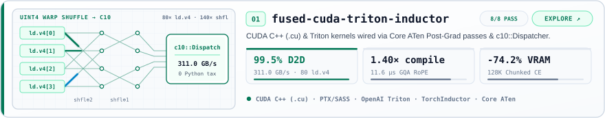
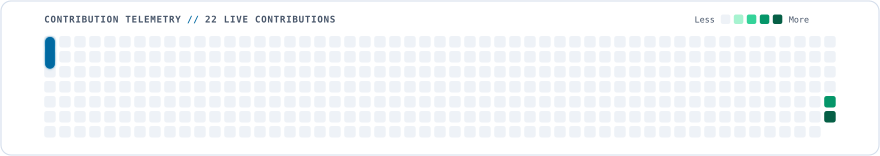

  <picture>
    <source media="(prefers-color-scheme: dark)" srcset="https://raw.githubusercontent.com/yuri-infra/yuri-infra/main/assets/hero-dark.svg">
    <source media="(prefers-color-scheme: light)" srcset="https://raw.githubusercontent.com/yuri-infra/yuri-infra/main/assets/hero-light.svg">
    
  </picture>

  <picture>
    <source media="(prefers-color-scheme: dark)" srcset="https://raw.githubusercontent.com/yuri-infra/yuri-infra/main/assets/roofline-telemetry-dark.svg">
    <source media="(prefers-color-scheme: light)" srcset="https://raw.githubusercontent.com/yuri-infra/yuri-infra/main/assets/roofline-telemetry-light.svg">
    
  </picture>

### `// FEATURED_SYSTEMS`

  <a href="https://github.com/yuri-infra/fused-cuda-triton-inductor">
    <picture>
      <source media="(prefers-color-scheme: dark)" srcset="https://raw.githubusercontent.com/yuri-infra/yuri-infra/main/assets/card-1-dark.svg">
      <source media="(prefers-color-scheme: light)" srcset="https://raw.githubusercontent.com/yuri-infra/yuri-infra/main/assets/card-1-light.svg">
      
    </picture>
  </a>

  <a href="https://github.com/yuri-infra/qwen-paged-serving">
    <picture>
      <source media="(prefers-color-scheme: dark)" srcset="https://raw.githubusercontent.com/yuri-infra/yuri-infra/main/assets/card-2-dark.svg">
      <source media="(prefers-color-scheme: light)" srcset="https://raw.githubusercontent.com/yuri-infra/yuri-infra/main/assets/card-2-light.svg">
      
    </picture>
  </a>

  <a href="https://github.com/yuri-infra/qwen-32k-longctx-train">
    <picture>
      <source media="(prefers-color-scheme: dark)" srcset="https://raw.githubusercontent.com/yuri-infra/yuri-infra/main/assets/card-3-dark.svg">
      <source media="(prefers-color-scheme: light)" srcset="https://raw.githubusercontent.com/yuri-infra/yuri-infra/main/assets/card-3-light.svg">
      
    </picture>
  </a>

  <picture>
    <source media="(prefers-color-scheme: dark)" srcset="https://raw.githubusercontent.com/yuri-infra/yuri-infra/output/github-contribution-grid-snake-dark.svg">
    <source media="(prefers-color-scheme: light)" srcset="https://raw.githubusercontent.com/yuri-infra/yuri-infra/output/github-contribution-grid-snake.svg">
    
  </picture>

---

  <a href="mailto:zhuhw26@m.fudan.edu.cn"><strong>zhuhw26@m.fudan.edu.cn</strong></a> &nbsp;·&nbsp; Shanghai, China (Fudan Univ. M.Eng.) &nbsp;·&nbsp; Available Dec 2026+ (3–6 mos, 4–5 d/wk) &nbsp;·&nbsp; GPU Kernels · Compilers · LLM Systems

